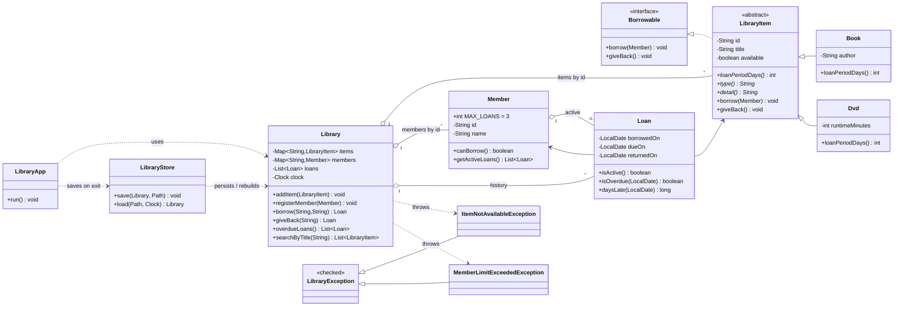

# Lab 11 Mini-Project: Library Management System

**Student:** Craig Mudyiwa | **Reg. No.** H250278R | **Department:** Software Engineering
**Course:** Object-Oriented Programming in Java
**Source:** [`src/lab11/library/`](../../src/lab11/library/) | **Run:** `run.bat library-demo` (scripted demo) or `run.bat library` (interactive)

---

## 1. Introduction

The Library Management System integrates every concept from Labs 1 to 10: classes with private state and validation, an abstract class hierarchy, an interface, custom checked exceptions, `Map`-based collections, CSV persistence, and stream queries behind a console menu. This report states the requirements, shows the design, explains the main decisions, and documents testing.

## 2. Requirements Traceability

| # | Requirement (from the manual) | Where it is met | Verified by |
|---|---|---|---|
| R1 | `Book`, `Member`, `Loan` with private fields, validation and `toString` | `Book`, `Member`, `Loan`, `Validation` | tests P.2 |
| R2 | Abstract `LibraryItem` (title, id); `Book` and `Dvd` each with `loanPeriodDays()` | `LibraryItem`, `Book` (21 d), `Dvd` (7 d) | tests P.1, P.3 |
| R3 | `Borrowable` interface with `borrow(Member)` and `giveBack()` | `Borrowable`, implemented by `LibraryItem` | tests P.1, P.3 |
| R4 | Custom exceptions `ItemNotAvailableException` and `MemberLimitExceededException` (max 3 loans) | `ItemNotAvailableException`, `MemberLimitExceededException`, `Member.MAX_LOANS` | tests P.4 |
| R5 | Items and members in `Map<String, ...>` keyed by id | `Library.items`, `Library.members` | tests P.2, P.4 |
| R6 | CSV persistence on exit, reload on start | `LibraryStore`, `Csv`; `LibraryApp.run()` saves, `main` loads | tests P.7 and the two-session demo |
| R7 | Menu: add item, register member, borrow, return, list overdue, search by title (streams) | `LibraryApp`; `Library.overdueLoans()`, `searchByTitle()` | tests P.5, P.6, P.8 |
| R8 | Class diagram and short report | Section 3 and this document | n/a |

## 3. Design

### 3.1 Class diagram



*(The diagram renders automatically on GitHub. In VS Code install a Mermaid preview extension; for a Word report, paste the code into <https://mermaid.live> and export as PNG.)*

### 3.2 Key design decisions

| Decision | Reason |
|---|---|
| **`Library` is separate from `LibraryApp`** | Single responsibility: business rules never print or read input, so they can be tested without a console, and the console can be replaced by a GUI or web layer. |
| **`Borrowable` is an interface; `LibraryItem` implements it** | Borrowing is a *capability*, not a type of thing; the interface expresses it independently of the class hierarchy. |
| **Loan period is an abstract method, not a field** | Each subclass decides (book 21 days, DVD 7). Adding `Magazine` means one new class; nothing else changes (open/closed principle). `Loan.start` calls `item.loanPeriodDays()` without knowing the item's real class. |
| **Checks before changes in `borrow`** | The limit and availability are both checked before any state is modified, so a failed borrow leaves the library untouched (tested: "failed borrow changed nothing"). |
| **`LibraryException` base class** | Callers can catch any expected business failure in one clause, while `ItemNotAvailableException` and `MemberLimitExceededException` still carry specific data (item id, member id). They are *checked* because they are expected, recoverable outcomes. |
| **`Map<String, ...>` keyed by id (`LinkedHashMap`)** | O(1) lookup, duplicate ids impossible (`putIfAbsent`), and insertion order is kept for stable listings and files. |
| **Injected `Clock`** | Overdue logic depends on today's date. Passing a fixed `Clock` in the demo and tests proves overdue detection without waiting for real days. |
| **Availability is derived, not stored in CSV** | After loading, an item is "on loan" exactly when it has an active loan, so the files cannot contradict themselves. |
| **Loan history is kept** | Returned loans stay in `loans.csv` with a return date, giving an audit trail and the data for late-return reporting. |
| **Own CSV quoting (`Csv`)** | A title such as *Design Patterns, Elements of Reusable Software* contains a comma and would be corrupted by a naive `split(",")`. The round trip is tested with commas and quotes. |
| **Atomic save** | Each file is written to a `.tmp` file and then moved into place, so a crash during saving cannot leave a half-written file. |
| **Validation in one helper** | `Validation.requireText` rejects blank and multi-line text for every id, title and name (no duplication; multi-line text would break the CSV format). |
| **Corrupt data reported, not ignored** | An unknown item type, a bad date or a duplicate active loan in a file produces an `IOException` naming the file and row. |

### 3.3 Where each OOP principle appears

| Principle | Evidence |
|---|---|
| Encapsulation | All fields private; `Member.getActiveLoans()` returns an unmodifiable copy; `Loan` state changes only through `markReturned`; package-private mutators (`addLoan`, `restoreLoan`) keep the rules inside the package. |
| Inheritance | `Book` and `Dvd` extend `LibraryItem` and reuse its id, title, availability and borrow logic. |
| Polymorphism | `Loan.start` and `Library.borrow` work on `LibraryItem`; the due date differs by subclass. `LibraryStore.save` calls `type()` and `detail()` polymorphically (no `instanceof`). |
| Abstraction | `LibraryItem` (abstract) and `Borrowable` (interface) define *what* an item does; subclasses decide *how*. |

## 4. How to Run

```bash
run.bat library-demo       # reproducible scripted demo (two sessions, 1 Oct and 25 Oct 2026)
run.bat library            # interactive menu; data stored in library-data/
run.bat library my-folder  # interactive menu with another data directory
```

Menu: `[1] Add item  [2] Register member  [3] Borrow  [4] Return  [5] Overdue  [6] Search title  [7] List items  [0] Save & exit`.
Data is saved to three files on exit (`items.csv`, `members.csv`, `loans.csv`) and reloaded at the next start. Menu input errors (non-numeric runtime, unknown ids, duplicate ids, invalid choice) print a message and return to the menu; they never crash the program.

## 5. Testing

43 automated checks (IDs `P.1` to `P.8` in [`tests/AllTests.java`](../../tests/AllTests.java)) cover:

| ID | Area | Examples |
|---|---|---|
| P.1 | Polymorphism | book = 21 days, DVD = 7 days, items are `Borrowable` |
| P.2 | Validation | blank/multi-line titles, non-positive runtime, duplicate ids, read-only loan list |
| P.3 | Borrow/return | availability flips, due dates, loan slot freed |
| P.4 | Exceptions | `ItemNotAvailableException`, `MemberLimitExceededException` at the 4th loan, failed borrow changes nothing, unknown ids, returning an item not on loan |
| P.5 | Overdue | none on borrow day; after 9 days only the DVD; after 24 days both, most overdue first; 17 days late on return |
| P.6 | Search (streams) | case-insensitive, sorted by title, no-match case |
| P.7 | Persistence | everything survives reload; availability rebuilt; commas and quotes in titles; corrupt file reported |
| P.8 | Menu | borrow, error messages, invalid choice, bad number, save on exit, end of input |

The two-session demo (`run.bat library-demo`) is the end-to-end test: session 1 saves, session 2 starts from a *new* `Library` that reloads the files and correctly reports the overdue DVD (17 days) and books (3 days).

### Demo output (excerpt, session 2 after reloading from CSV)

```text
Reloaded 4 items, 2 members, 3 loan records.
Choice: 5
Overdue items (as of 2026-10-25):
  D001 Inception                      Tariro Moyo    due 2026-10-08 (17 days overdue)
  B001 Clean Code                     Tariro Moyo    due 2026-10-22 (3 days overdue)
  B002 Effective Java                 Tariro Moyo    due 2026-10-22 (3 days overdue)
Choice: 4
Item id: D001
Returned: Inception -> Tariro Moyo, due 2026-10-08, returned 2026-10-25  ** 17 day(s) late **
```

## 6. Limitations and Possible Extensions

- Single-user console program; there is no locking if two programs use the same data directory.
- Late fees are reported as days late but no fine is calculated; a `FineStrategy` (Strategy pattern from Lab 11) would be the natural extension.
- Items cannot be removed or edited, and members cannot be deleted (kept simple to protect the loan history).
- Adding another item type (for example `Magazine` with a 3-day loan) needs one subclass and one `case` in `LibraryStore.load`.

## 7. Conclusion

The system meets every stated requirement. The business rules live in a testable `Library` class, the OOP principles are visible in the design rather than bolted on, and persistence is verified across a real save, reload and continued use.
